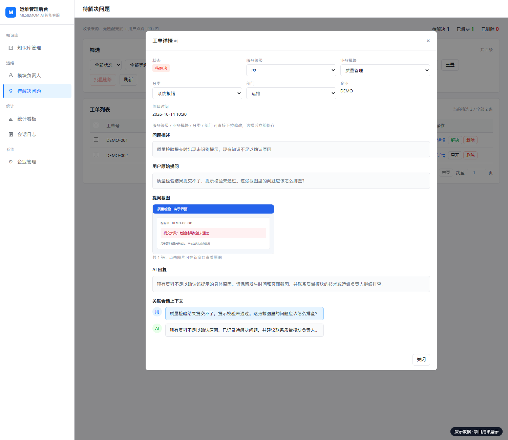
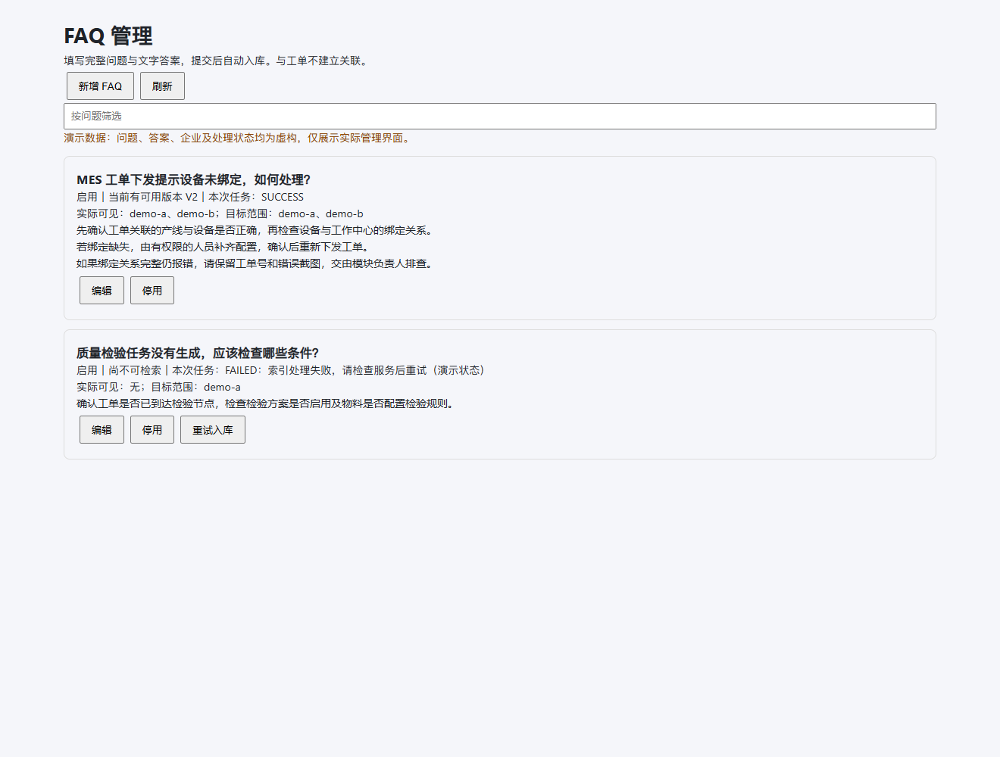
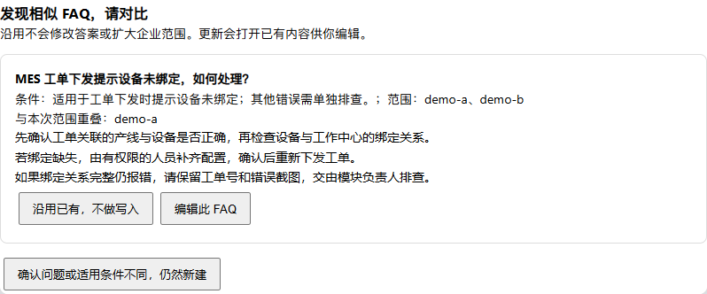
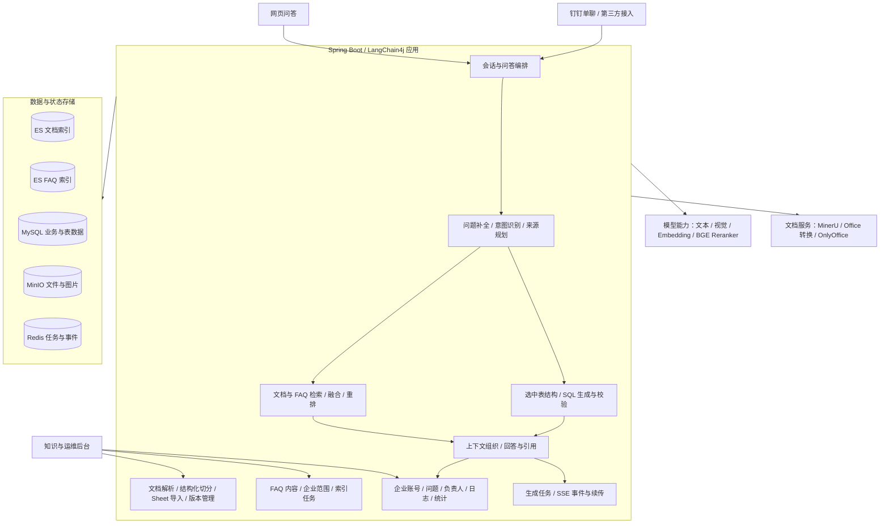
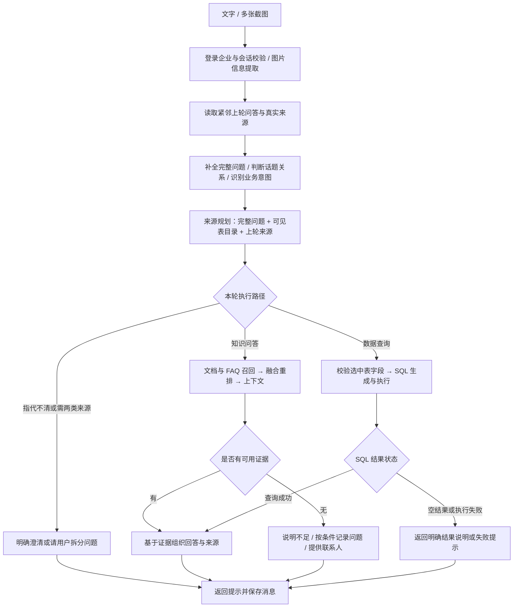
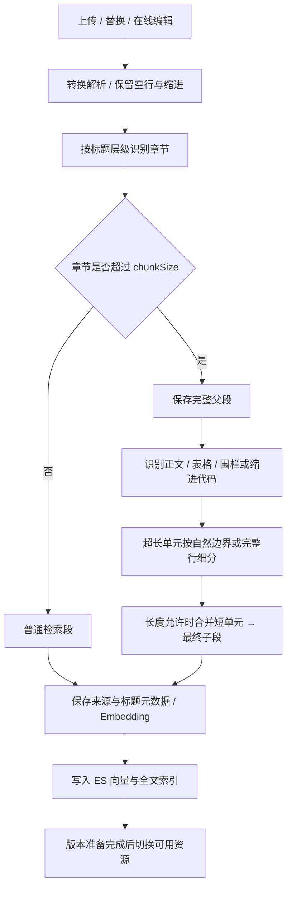
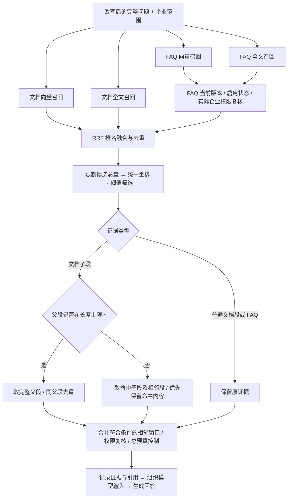
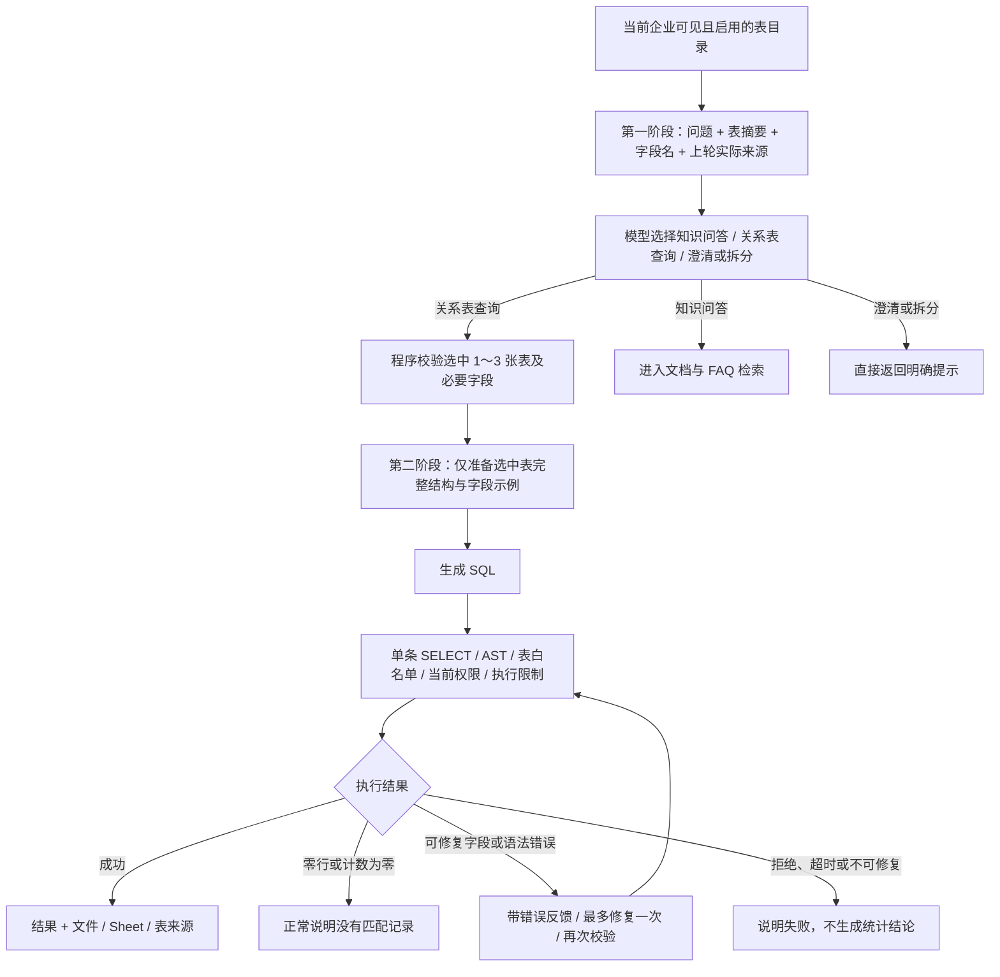
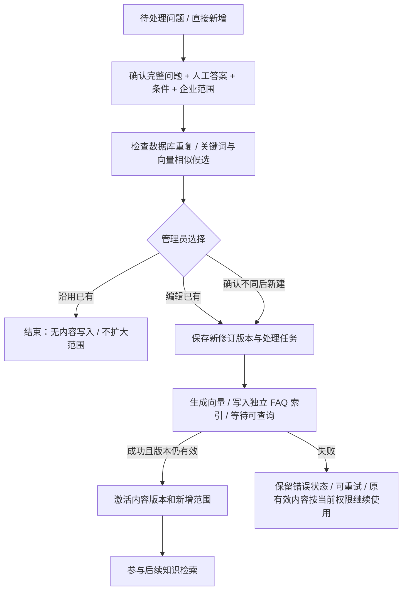
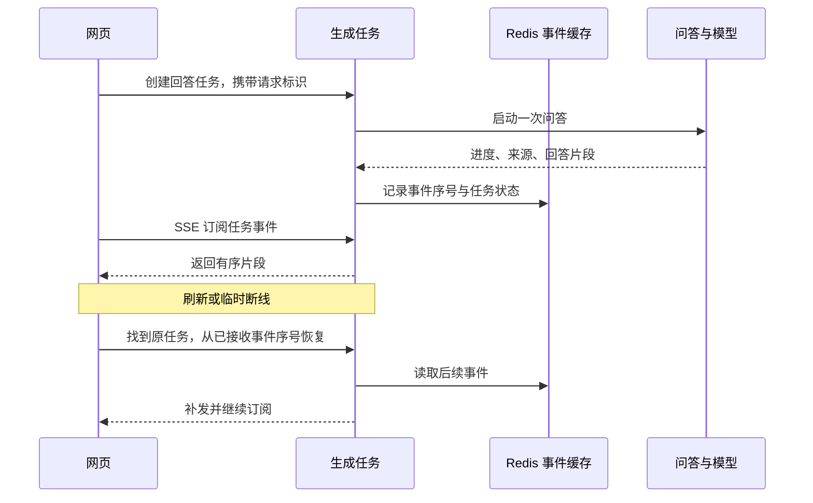

<div align="center">

# MES / MOM 运维智能助手 · 文曲星

**连接操作文档、表格数据与人工处理经验，形成可追溯的运维问答与知识沉淀闭环。**


[项目概览](#项目概览) · [功能展示](#功能展示) · [系统架构](#系统架构) · [核心流程](#核心流程) · [仓库说明](#仓库说明)

</div>


> 本仓库面向项目交流与面试展示，公开功能、架构、核心流程和界面截图。业务源码仅保留空目录结构，不提供运行包。截图使用真实前端和虚构演示数据，不包含客户资料、真实联系方式、访问凭据或商业源码；截图中的统计数值不代表业务规模与模型效果。内容依据当前开发实现整理，功能状态见文末说明。

## 项目概览

MES（制造执行系统）与 MOM（制造运营管理）涉及生产、设备、质量等多个业务模块。运维问题通常分散在操作手册、接口说明、Excel 清单和人工处理经验中：用户既可能问“这个错误怎么处理”，也可能问“符合条件的记录有多少”，回答不了时还需要找到负责人继续跟进。

文曲星以 **Java + Spring Boot + LangChain4j** 构建问答与管理应用，将这些需求连接为三类能力：

| 用户需要 | 系统如何处理 | 可见结果 |
| --- | --- | --- |
| 查操作、排错步骤和已有处理经验 | 检索文档与 FAQ，统一融合、重排并组织证据 | 带文档或 FAQ 来源的回答 |
| 查数量、清单、筛选结果 | 先判断来源并选表，再生成、校验和执行只读 SQL | 数据库查询结果及文件、Sheet 来源 |
| 连续补充模块、页面或报错信息 | 补全本轮问题，结合上轮问答和实际来源重新规划 | 承接上下文的回答或明确澄清 |
| 模型无法充分回答 | 提示当前限制，按条件记录问题，提供后台维护的模块联系人 | 待处理事项与后续处理入口 |
| 把人工解答变成可复用知识 | 确认完整问题、答案、适用条件和企业范围，检查重复后入库 FAQ | 后续提问可再次检索的标准答案 |

系统包含网页问答、知识维护、企业与账号管理、问题处理、负责人管理、日志与统计，同时保留钉钉接入能力。

## 功能展示

以下问题均为说明功能而构造的演示场景，答案取决于实际上传资料与授权范围。

### 1. 文档问答：从业务问题定位操作依据

**示例：**“工单下发提示设备未绑定，应该检查什么？”

- 用户用自然语言提问，系统在企业可见资料中检索相关片段，再结合证据组织步骤。
- 回答支持流式输出，用户可以展开依据查看来源文档及原文片段。
- 支持历史会话、重新提问与反馈，便于围绕同一问题继续排查。
- 依据不足时进入明确的提示与问题跟进流程，避免把“没有资料”包装成确定操作结论。

上方首页截图展示回答与依据在同一会话中的呈现方式。

### 2. 多轮追问与图片提问：保留问题对象和排查线索

**示例：** 先问“设备绑定失败怎么处理”，再补充“是下发页面，提示 E01”。

- 读取紧邻的上一轮问答，补全本轮指代，区分话题延续与切换；上一轮保存的完整问题也会参与后续理解。
- 话题延续不直接等于沿用原表：来源规划根据问题和真实来源判断应继续查表、改查文档还是澄清。
- 支持随提问附上多张截图，通过视觉模型提取报错或页面信息，再结合用户文字进入问答。
- 截图与原始提问会在待处理问题详情中保留，便于人工排查；识别结果仍需结合文字与知识证据判断。
- 网页回答生成与 SSE 连接分离：刷新或短暂断线后，按事件序号恢复已有输出；用户可显式停止生成。续传依赖事件缓存有效，不代表进程崩溃后自动继续模型推理。

### 3. 表格查询：统计与明细来自数据库执行结果

**示例：**“接口清单里有多少个接口？”→“列出其中几个接口的名称和请求方式。”

- 第一轮选择与问题匹配的表，用 SQL 完成计数；下一轮根据保存的实际来源判断是否继续查询同一批记录。
- 回答展示“文件名 → Sheet”，用户可以确认数量与明细来自哪份清单。
- 操作说明类问题与数据统计类问题使用不同路径；如“接口怎么配置”应结合资料用途与真实字段判断，不仅凭“接口”关键词选表。
- SQL 生成前只提供选中表的完整结构与少量字段示例；执行前校验只读语句、允许访问的表和当前可见范围。
- 查询成功、结果为空与查询失败分别处理：计数为 0 是有效结果，执行失败不能生成一个假数量。


### 4. 文档管理：从原文件到可检索知识

- 维护 Word、PDF、Markdown、Excel 与 CSV，按文件类型进入文档处理或表格导入路径。
- 文档经过转换、解析、切分与向量化，管理端展示处理状态与进度；支持启停、编辑、替换和重新处理。
- 文本按配置的标题层级组织章节；超长章节保留父段，在章节内识别正文、表格与代码，切成参与检索的子段。
- 子段优先沿段落、换行与句末边界切分，短内容在长度允许时合并；超长表格按行分组并重复表头，代码分组保留语言标记、缩进与围栏。
- 分段详情区分普通段、父段和子段，便于查看实际入库内容。`chunkSize` 是长度上限，实际切点会受结构与自然边界影响。


### 5. 多 Sheet 导入：工作表分别建表、分别反馈

- 上传后识别工作表，用户选择需要导入的 Sheet，按第一行为表头的规则校验。
- 每个有效 Sheet 独立创建数据表，保存文件、Sheet、字段结构与用途等元信息。
- 导入结果按 Sheet 展示成功与失败；一张表失败不阻止其他有效表导入。
- 表数据与当前可用版本准备完成后进入可查询范围，不把 Excel 的局部文本召回结果当成全表统计。


### 6. 资料不足后的人工跟进：保留当时发生了什么

问题符合收录条件时进入待处理列表。处理人员可以查看、校正分类并跟进解决状态。




| 详情内容 | 用途 |
| --- | --- |
| 问题描述、用户原话、AI 当时的回答 | 区分用户遇到的情况与模型如何理解、回答 |
| 本轮截图与关联会话 | 查看报错与前后沟通，减少反复询问 |
| 服务等级、模块、分类和部门 | 人工纠正识别结果，按实际情况跟进 |
| 已解决、重新打开等状态操作 | 持续管理处理结果 |
| 文字解答与“带入 FAQ 表单”入口 | 把确认后的处理经验整理成可复用知识 |

模块明确时，程序查询后台维护的负责人表，分别提供业务、技术、运维联系人及联系方式。联系人来自固定业务记录。


### 7. FAQ 知识沉淀：让人工处理经验进入后续问答

**示例：** 某类故障已经人工确认处理方法，管理员将完整问题和处理步骤整理为标准问答。

- 可从工单带入**本轮改写后的完整问题**与人工答案，也可直接新增；本轮改写问题缺失时留空提示人工补全，不误用其他轮次的问题。
- 管理员确认标准问题、文字答案、模块、适用说明与可见企业。答案最多 **2000 字符**，不支持图片；提交后自动处理，无额外审核或发布按钮。
- 提交前展示相同问题与语义/关键词相似候选，方便对比答案、条件与企业范围；显示范围重叠情况。
- 支持**沿用已有、编辑已有、确认不同后新建**。沿用不会修改原答案或扩大权限；不同系统版本、适用条件的相似问题允许分别保留。
- FAQ 不保存工单关联、不扩展相似问法列表；企业范围由管理员独立选择。





入库后，FAQ 与文档一起参与知识问答：分开索引、共同召回、统一重排。命中 FAQ 不直接跳过文档；条件一致时优先参考人工标准答案，文档补充相关细节。条件不足或资料冲突时，提示词要求说明限制或澄清，该约束仍需模型效果评测。

FAQ 更新保留内容版本。撤销企业权限在提交时生效，新增企业权限等新索引准备完成后生效；处理失败可以重试。管理端展示任务状态与当前可用版本，不把更新失败等同于旧答案失效。

### 8. 企业与账号：明确哪些资料可被谁使用

- 通过用户所属企业限制文档、结构化表与 FAQ 的可见范围，支持指定企业或全部企业资料。
- 表格规划、SQL 执行、FAQ 召回与详情读取分别校验当前权限，模型选择不能授予访问权。
- 当前管理端沿用内网管理模式，可管理所有企业；用户问答端使用实际登录企业过滤，不混淆“管理入口权限”与“知识可见范围”。

### 9. 日志与统计：回看回答依据和问题分布

- 会话日志支持筛选、详情与导出，保留问题、回答、来源和反馈。
- SQL 日志保存最终语句与执行状态；来源规划记录选择路径、表和原因，便于区分来源选择与执行问题。
- 看板展示问答量、响应耗时、待处理问题、高频问题与模块分布，并提供模块异常预警。


### 10. 钉钉接入：复用同一套问答能力

保留企业内部单聊与第三方企业接入两种模式，采用独立配置并互斥启用。消息进入后转换成统一问答请求，复用问题理解、企业范围、来源规划和回答生成，再将结果返回对应渠道。接入代码不等于真实平台联调已完成，仍需有效凭据和平台环境验收。

## 系统架构

系统采用 **Spring Boot 单体业务应用 + 独立存储、文档与模型服务**。下图的内部区域表示同一应用中的职责模块，不是独立部署的微服务。



| 组件 | 职责与数据 |
| --- | --- |
| Java 21、Spring Boot、MyBatis-Plus | 业务 API、权限判断、状态转换、查询执行与持久化 |
| LangChain4j、文本与视觉模型 | 问题理解、来源规划、SQL 生成、截图理解与答案组织 |
| Elasticsearch 文档索引 | 文档子段/普通段的向量与全文检索，关联标题、父段及来源 |
| Elasticsearch FAQ 索引 | 独立保存 FAQ 版本、企业范围、全文与问题向量，数据库复核有效性 |
| BGE Reranker、ONNX Runtime | 对融合后的知识候选统一评分；文档先重排子段，再展开父段 |
| MySQL | 会话、消息、工单、联系人、企业、文档元数据、FAQ 版本任务及 Excel 导入表 |
| MinIO、文档转换与在线编辑服务 | 原文件、解析产物、图片及文档编辑 |
| Redis | 生成任务与事件缓存、渠道会话映射、锁与任务状态；网页对话历史读取数据库记录 |
| 原生 HTML / CSS / JavaScript、SSE、ECharts | 问答、流式恢复、管理界面与统计图表 |

**职责分工：** 模型处理语义判断与生成；程序执行企业范围校验、表与字段存在性检查、SQL 安全规则、内容预算和版本切换。两个 ES 索引共享部署资源，不等于物理资源隔离。

## 核心流程

### 1. 一次提问：先补全问题，再决定查哪里



来源规划有三个要点：

1. **不按关键词硬分流。** “设备有多少条”与“设备台账页面怎么打开”可能走不同路径，依据资料用途和真实字段判断。
2. **延续话题不等于强制查原表。** 是否沿用上轮来源由规划结果明确给出，程序重新校验可见性和启用状态；来源已不可用时提示用户。
3. **本轮选择单一来源路径。** 同时要求统计数据与解释文档、需要两类来源才能完成时，提示拆分问题；当前没有把旧的 SQL + 知识库双路执行保留为默认路径。

### 2. 文档入库：标题组织父段，结构化切分形成子段



`Piece` 是切分过程中临时识别的正文、代码或表格行组，`Chunk` 是最终保存和检索的段。先保护结构并细分超长单元，再组合短单元，避免把每一小段或空行都单独存成检索结果。当前不提供 overlap 参数；不跨块重复拼接正文。

长表格会重复表头、代码片段会补齐围栏，这是为了让独立片段保留结构，并非正文 overlap。标题路径、父子关系和来源位置保留在元数据中。

### 3. 知识检索：子段重排之后，再补充回答上下文



| 控制点 | 当前行为 |
| --- | --- |
| 跨索引分数 | 用 RRF 综合排名，不直接比较 FAQ 与文档的原始 ES 分数 |
| 重排成本 | 融合后候选上限 20，重排筛选最多 8 条；FAQ 每路最多 5 条有效候选 |
| 父段展开 | 当前长度阈值为 4000 字符；超长父段取命中子段与相邻段，邻段按预算裁剪 |
| 多次命中 | 完整父段去重；同父段的重叠窗口在合并后仍符合上限时合并，保留远处独立命中 |
| 最终内容预算 | 当前每条 4000、合计 30000 字符；这是证据字符预算，不是模型完整输入的 token 上限 |
| FAQ 证据 | 不展开父段；问题、条件、答案整体放入，放不下整体略过，继续考虑后续证据 |
| FAQ 故障 | 有限等待，超时或权限复核失败丢弃该来源，其他来源继续处理 |

这些数字是当前开发配置与实现上限，可随部署调整。FAQ 不因类型而自动成为答案：还需要通过相关性筛选，生成时结合适用条件判断。SQL 的结构化查询结果直接进入结果处理，不参与知识片段的 RRF 和语义重排。

### 4. Text2SQL：先规划来源与选表，再提供详细结构生成 SQL



- 第一阶段不采样表数据，不把所有表的完整结构直接交给 SQL 生成模型；查知识时也不进行字段示例查询。
- 选表范围与字段存在性由程序核对。模型选择失败或校验不通过时回到知识路径，不自动扩大到所有表尝试生成 SQL。
- 执行前重新校验表当前可见性，限制为只读查询，并拦截系统库、危险函数、导出和锁定操作；查询有超时和结果行数限制。
- 修复不能通过换表、删除条件或放宽筛选来制造“有结果”。空结果不触发这种重试。

### 5. 人工经验如何回到问答：独立 FAQ 内容与索引版本



例如，可见范围由 A/B 改为 A/C：提交成功后 B 立即撤权；索引准备期间 A 仍可用旧答案，C 暂未获权；成功后 A/C 使用新版本。失败不会恢复 B 的权限。停用会立即禁止读取，迟到任务不能重新启用该 FAQ。

### 6. 流式回答与刷新恢复：连接断开，任务仍有独立状态



恢复接口校验当前账号、企业及会话归属。同一请求重试复用原任务；重连不会重新提交一遍模型问题。缓存过期或执行进程失效需要按实际任务状态处理，不能仅靠 SSE 协议自动恢复推理。

## 仓库说明

### 实现与展示范围

- 本说明反映截至 **2026-10-24** 的开发实现。FAQ 和网页流式续传已接入当前代码；FAQ 已完成本地事务、权限、并发、索引请求及表单自动化验证，仍需真实 MySQL、ES、模型与业务场景联调，不写作已完成生产验收。
- 本页不以估算填写模型准确率、延迟或提升比例；界面数据均为虚构示例。
- 系统用于资料查询和运维协助，不直接修改生产工单、设备参数或 ERP 业务数据。
- 公共仓库仅发布展示资料和空代码目录，商业源码、真实配置、提示词正文、SQL 脚本、模型权重及客户文件不在公开范围。

### 目录结构

```text
MES-MOM/
├── README.md                       # 项目概览、功能、架构与核心流程
├── assets/screenshots/             # 真实界面 + 虚构数据的展示截图
└── src/                            # 代码目录结构，只有空 .gitkeep 占位
    ├── main/
    │   ├── java/cn/lile/llm/mentor/ai/engine/
    │   │   ├── ai/                 # AI 接口
    │   │   ├── auth/               # 登录与账号校验
    │   │   ├── business/           # 账号数据与业务实体
    │   │   ├── chat/               # 会话、消息、问题补全与流式任务
    │   │   ├── common/             # 公共组件与异常
    │   │   ├── config/             # 应用配置
    │   │   ├── dingtalk/           # 钉钉接入
    │   │   ├── document/           # 文档、Sheet 与资源版本
    │   │   ├── faq/                # FAQ 管理、权限、索引任务与检索
    │   │   ├── infra/              # 基础设施适配
    │   │   ├── ops/                # 企业、联系人、问题、日志与统计
    │   │   └── rag/                # 路由、切分、检索、重排与 SQL
    │   └── resources/              # 仅保留 model / prompts / sql / static 目录
    └── test/                       # Java 与 JavaScript 测试目录占位
```

Git 不追踪空目录，因此用零字节 `.gitkeep` 展示模块组织。本仓库用于了解系统能力与设计，不提供独立部署所需的源码和环境配置。
