<div align="center">

# MES / MOM 运维智能助手

**把业务文档、Excel 清单与运维知识，连接到可追溯的智能问答。**


[项目概览](#项目概览) · [功能展示](#功能展示) · [技术架构](#技术架构) · [核心流程](#核心流程) · [工程实践](#工程实践)

</div>

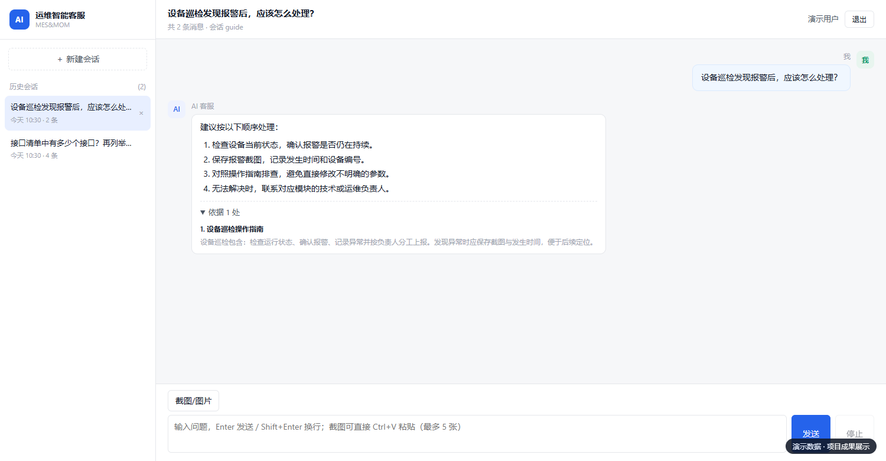

> 本仓库用于项目成果展示，保留功能介绍、架构设计、界面截图与代码目录结构。代码目录仅用空的 `.gitkeep` 文件占位，不包含实现内容。截图来自项目实际前端，使用虚构演示数据；不包含客户文档、生产数据、企业联系方式、访问凭据或商业项目源码。截图中的数量和统计指标不代表真实业务规模或模型效果。

## 项目概览

MES（制造执行系统）与 MOM（制造运营管理）覆盖生产、设备、质量等多个模块。运维人员遇到问题时，往往需要在操作手册、接口说明和 Excel 清单中寻找答案，再确认应由谁处理。

本项目以 Java 为主要开发语言，把这些资料组织成可查询的知识库，提供 **文档问答 + 表格查询 + 运维问题跟进**。系统根据问题选择检索路径，回答时保留来源；资料不足时记录问题，并按模块提供对应负责人。

**它既包含 AI 问答链路，也包含知识维护、账号与企业管理、日志审计和统计看板。**

### 能力一览

| 场景 | 系统能力 |
| --- | --- |
| 查操作与排错步骤 | 检索文档片段，结合上下文生成回答，展示回答依据 |
| 查数量、清单与明细 | 从 Excel 工作表选择合适的数据表，生成并校验只读 SQL |
| 连续追问 | 读取会话历史，在指代明确时沿用上一轮表格来源 |
| 发送异常截图 | 通过视觉模型提取截图信息，结合文字进入问答流程 |
| 维护知识 | 上传、转换、切片、向量化、启停、在线编辑与重新入库 |
| 资料不足 | 记录待解决问题，提供模块负责人，形成知识补充入口 |
| 回看与运营 | 查询会话与依据、查看 SQL 审计、导出日志、查看统计看板 |

## 功能展示

### 1. 文档问答：回答与依据放在一起

支持历史会话、连续提问与流式输出。文档回答可以就近展开依据，查看对应文档与原文片段，方便使用者判断答案是否有支撑。

### 2. Excel 查询：从自然语言到结构化结果

支持统计、列举与条件查询。表格回答展示“文件名 → 工作表名”，帮助用户确认查的是哪份清单；明确的连续追问可复用上一轮来源。

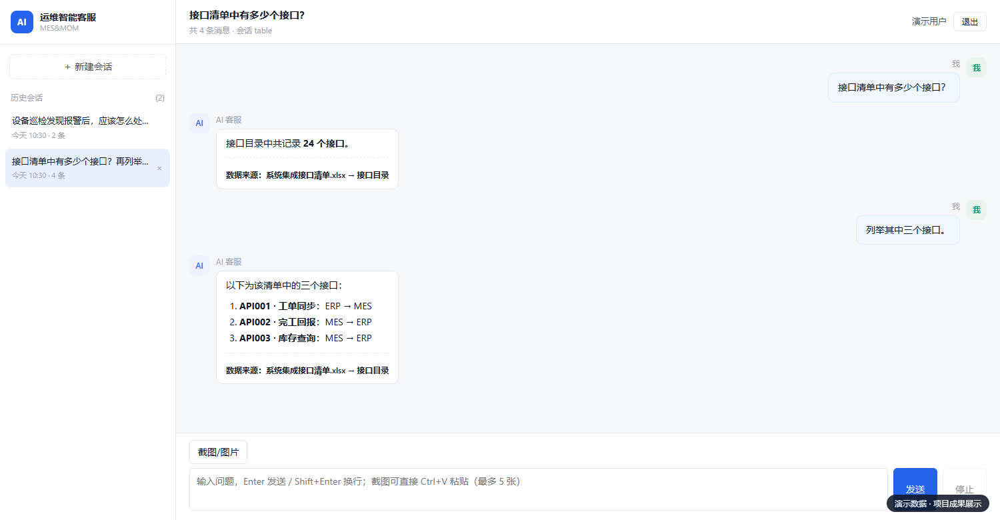

### 3. 知识库：让处理过程可见

统一维护 Word、PDF、Markdown、Excel 与 CSV。文档上传后转换为可处理内容，通过切片和向量化进入检索；界面展示处理进度，处理中禁用删除，避免操作与后台任务互相影响。

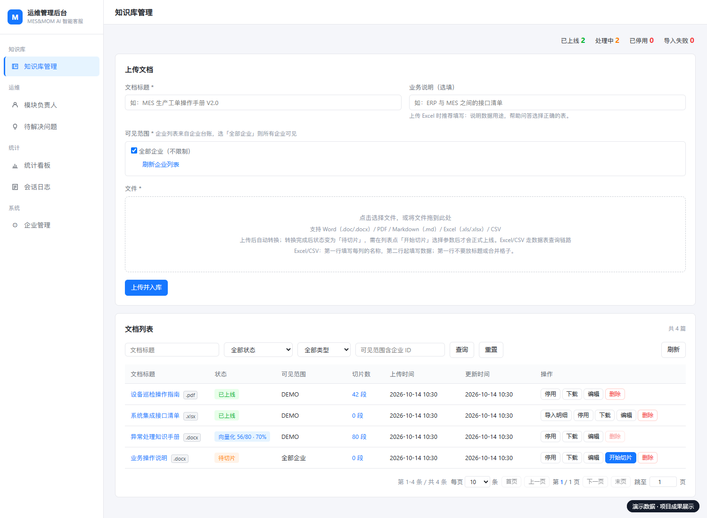

### 4. 多工作表导入：每张 Sheet 独立处理

上传前解析工作表，支持选择导入范围。按照“第一行为表头”的统一规则校验，每张选中的 Sheet 独立建表，逐张记录成功或失败，某一张失败不影响其他有效工作表。

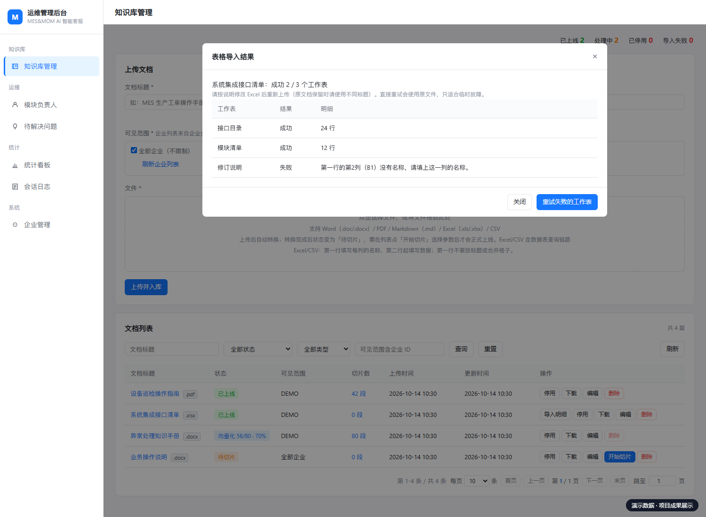

### 5. 模块负责人：资料不足时也有下一步

通过后台直接维护业务、技术、运维三类负责人及各自联系方式。问答无法充分解决且模块明确时，程序查询固定业务表提供联系人，避免让模型猜测人员信息。

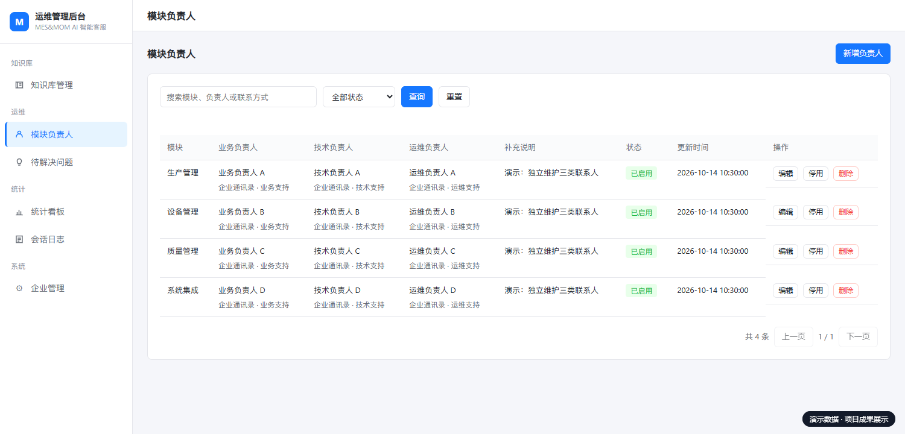

### 6. 会话审计与问题跟进

会话日志记录问题、回答、来源与反馈，支持筛选、详情和导出；SQL 查询额外保留最终语句与执行状态。未解决的问题进入待解决列表，供运维人员处理与补充知识。

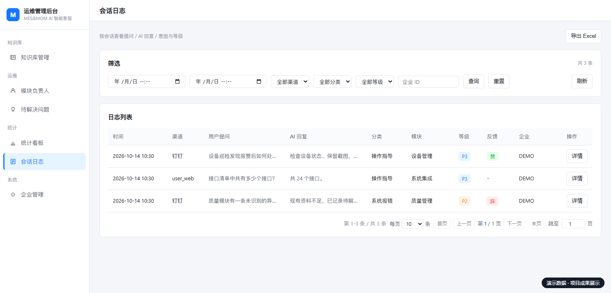

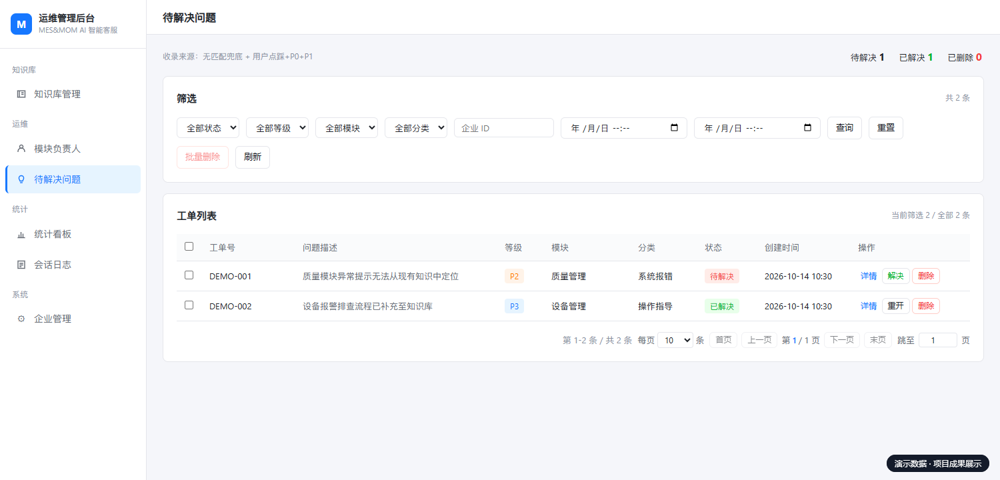

### 7. 统计看板

展示问答量、响应耗时、问题记录、高频问题与模块分布，并提供模块异常预警。这里的数值均为界面展示用的演示数据。

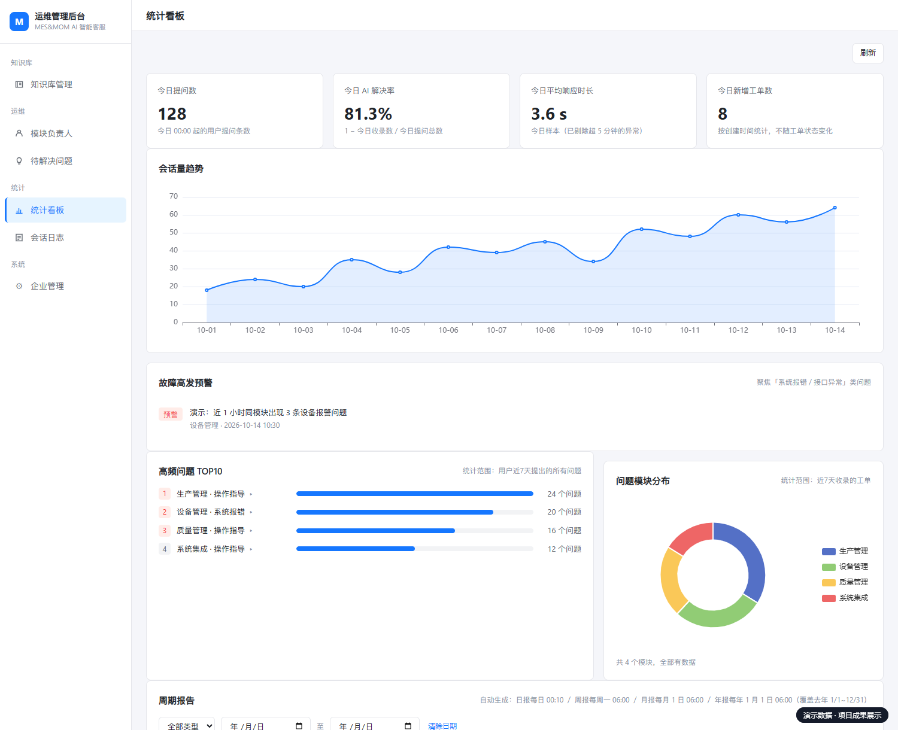

## 技术架构

系统采用 **Spring Boot 单体应用 + 独立文档与模型服务**。Java 应用承担业务编排、权限范围、数据查询和资源状态管理；模型负责理解与生成，业务状态由程序控制。

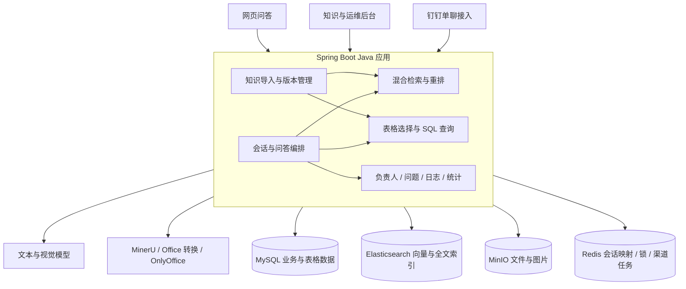

| 层次 | 主要技术 | 用途 |
| --- | --- | --- |
| 业务后端 | Java 21、Spring Boot、MyBatis-Plus | API、业务编排、数据持久化 |
| AI 集成 | LangChain4j、OpenAI 兼容模型接口 | 文本生成、视觉理解、Embedding |
| 文档检索 | Elasticsearch、BM25、向量检索、RRF | 融合关键词与语义召回 |
| 精排 | BGE Reranker、ONNX Runtime | 对候选片段进一步排序 |
| 表格处理 | EasyExcel、MySQL、Druid SQL AST | 工作表解析、结构化存储、SQL 安全校验 |
| 文件服务 | MinIO、MinerU、Office 转换、OnlyOffice | 原文件、解析产物、截图与在线编辑 |
| 状态与任务 | Redis、Spring 定时任务 | 会话映射、互斥锁、重试与资源清理 |
| 用户界面 | 原生 HTML / CSS / JavaScript、SSE、ECharts | 流式问答、管理页面、可视化统计 |
| 渠道 | 钉钉 Stream 与机器人 API | 企业内部单聊；保留第三方企业接入能力 |

钉钉内部与第三方模式采用独立配置并互斥启用。企业内部接入代码已实现，仍需完整凭据与真实平台联调；仓库展示不把它标为已完成生产验证。

## 核心流程

### 问答如何选择路径

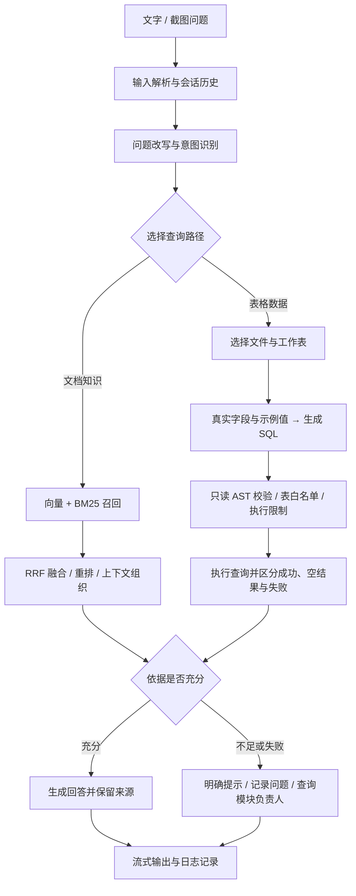

字段示例值由程序采样；表头规则由代码校验。模型调用主要用于问题理解、来源选择、SQL 生成和答案组织，避免把确定性的业务处理交给模型。

### 文件如何进入知识库

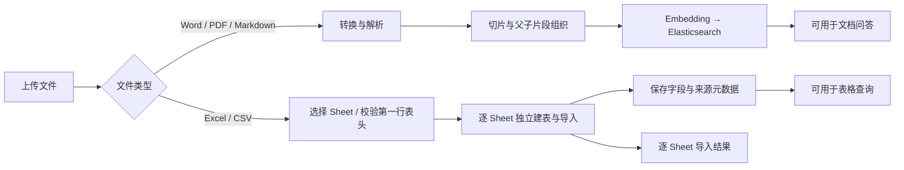

## 工程实践

相较于“文档切片 → 向量检索 → 拼接提示词”的基础 RAG，本项目进一步处理了 **结构化统计、来源连续性、检索性能、知识更新一致性与运维跟进**。下面按实际问题展开，而不是只罗列用了哪些框架。

### 亮点一：把“解释资料”和“统计数据”交给不同链路

**问题：** 用户问“接口清单有多少个接口”，如果只把 Excel 转成文本再取 Top-K 片段，召回的内容可能只是清单的一部分；模型即使认真数，也不能保证统计完整。

**处理思路：** 文档用于理解、解释与排错；规范表格进入关系型数据库，用 SQL 完成计数、筛选与列举。一个文件对应多个 Sheet，每个有效 Sheet 独立建表，保留文件与工作表来源，避免把“整个文件”和“某张清单”混为一谈。

**链路：** 选择数据来源 → 提供真实字段与程序采样的示例值 → 生成只读 SQL → 程序校验 → 数据库执行 → 按结果组织回答。

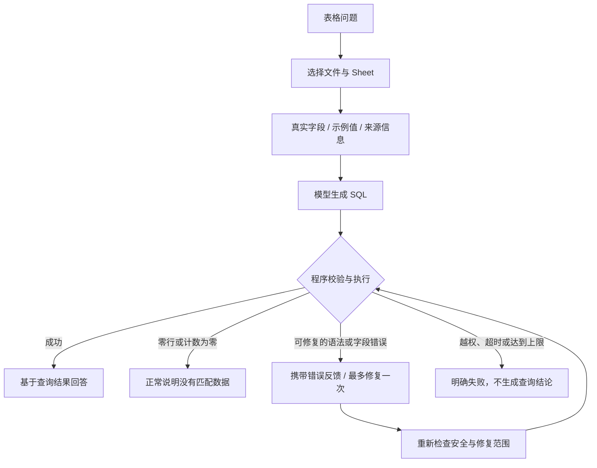

**一个关键取舍：** 查询到 0 不会触发“为了得到结果而放宽条件”的重试。SQL 修复有次数上限，并校验表来源、字面值和查询结构；对于可解析的字段错误，允许修正字段标识，但不允许悄悄换表或删除过滤条件。数量由数据库计算，模型负责解释结果。

### 亮点二：两段式选表，先缩小结构上下文再生成 SQL

**问题：** 多个文件各自包含多个 Sheet，导入后会形成较多数据表。把所有表的完整建表语句一次性塞给模型，会增加输入长度，也让无关表、同名字段和同名工作表干扰 SQL 生成。

**处理思路：** 将来源选择与 SQL 生成拆成两段，第一段只看较轻的表摘要，第二段再看选中表的完整结构。

| 阶段 | 给模型的信息 | 产出 |
| --- | --- | --- |
| 第一段：摘要选表 | 问题、候选表名、来源文件、文档标题、Sheet、业务说明及字段含义 | 回答该问题需要的表名 |
| 第二段：生成 SQL | 选中表的完整 DDL、来源信息与程序采样的字段示例值 | 待程序校验的查询语句 |

第一段结合文件与 Sheet 等来源信息判断用途，而不是仅凭物理表名或同名工作表匹配。模型输出会与已知候选表核对，并限制选中数量；第二段才注入完整结构，减少无关表结构进入 SQL 提示词。

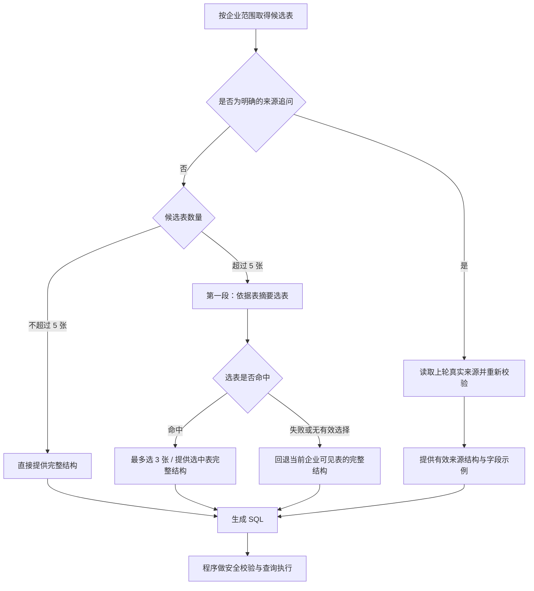

**取舍与边界：** 两段式比直接生成 SQL 多一次选表模型调用，因此不是每个问题都启用。表少时跳过摘要选表，明确追问优先使用已有来源；选表失败则回退，保留查询机会，但此时不再保证输入缩减。选表是上下文优化，执行权限仍由企业可见范围与资源启用状态决定，不能由模型决定。

### 亮点三：追问记住实际查过的表，而不只记住聊天文字

**问题：** 第一轮问“有多少个接口”，第二轮只说“列举其中几个”。第二句话几乎没有文件或模块信息，每轮重新选表容易跳到另一份资料。

**处理思路：** 回答落库时保存真实查询来源。识别到明确指代时，程序读取紧邻上一条回答的结构化来源，取得实际物理表；随后重新校验该表当前是否启用、是否对用户所属企业可见。

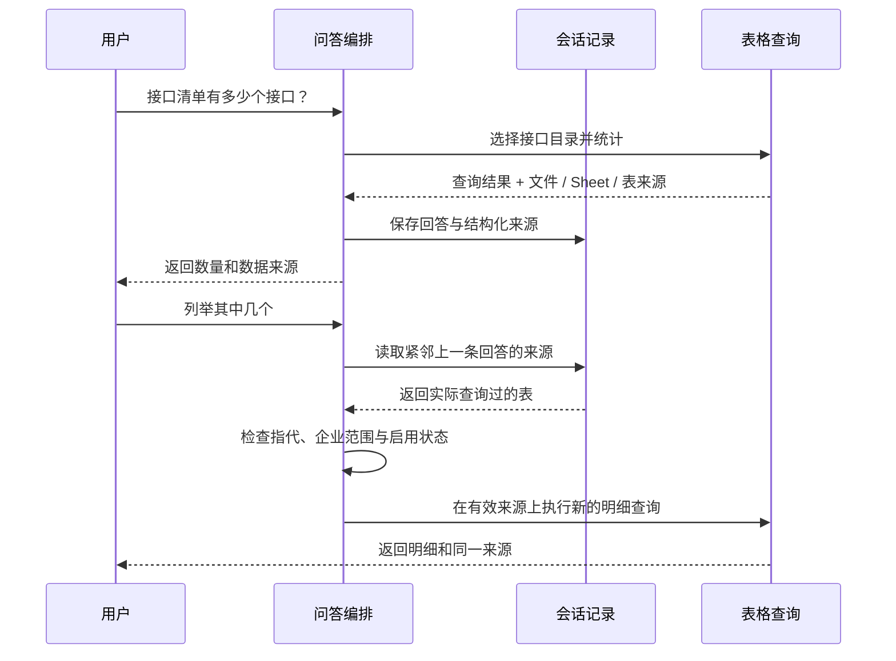

**边界：** 目前用明确指代与继续查询表达识别追问；“换一份”“不要查这个”等切换表达优先。上一条回答没有 SQL 来源时，不继续翻找更早的表，避免把旧话题带进来。这一步读取会话记录，不增加一次 LLM 调用。

### 亮点四：先用小片段精排，再展开上下文

**问题：** 小切片容易检索到关键句，却可能缺少上下文；直接把完整章节送去重排，又会增加候选文本长度与推理开销，挤占输入预算。

**处理思路：** 把“用来匹配的内容”与“用来回答的上下文”分开。先对小片段进行混合召回、融合与重排，再对最终候选展开父片段，而不是在重排之前扩大每个候选。


同一父片段只展开一次，避免重复占用上下文；父片段缺失或过长时保留原来的子片段，不直接丢掉已命中的依据。这个设计同时照顾检索精度、上下文完整性和重排成本。

### 亮点五：更新知识时，让旧版一直可用到新版发布成功

**问题：** 在线编辑或覆盖上传后，如果先删除旧向量与旧表，再开始处理新文件，转换失败就会让原来可用的知识消失；新旧数据同时存在时，又可能检索到两个版本。

**处理思路：** 每次更新准备独立的资源版本。新版的文件、向量或 Excel 表准备完成后，才切换当前版本；发布时校验原版本，避免并发更新覆盖。失败则保留旧版，成功后登记旧资源，交给定时任务清理。

**链路：** 编辑保存 / 覆盖上传 → 准备新版本 → 转换、切片与向量化或 Sheet 导入 → 检查并切换当前版本 → 检索按当前版本过滤 → 定时清理旧资源。

清理记录包含版本与切换时间，任务分页处理并使用分布式锁；文件、向量与数据表按各自结果记录失败，后续继续重试。**发布是否成功与清理是否成功分别处理**，不因删除旧文件暂时失败而否定已经完成的发布。

### 亮点六：把“回答不了”设计成一条完整业务路径

**问题：** 知识不足时，直接让模型继续回答容易产生没有依据的建议；只回复“没有找到资料”，又没有给运维人员下一步。

**处理思路：** 对“资料不足”“没有匹配数据”“查询执行失败”作不同处理。模块明确时，由程序查询固定业务表提供负责人；符合收录条件的问题进入待解决列表，交给人员跟进，并为后续补充知识提供入口。

**链路：** 判断结果状态 → 明确告知当前情况 → 按模块查询负责人 → 按条件收录问题 → 人员跟进与补充知识 → 后续问题从更新后的知识库检索。

联系人由后台维护，业务、技术、运维三类人员和联系方式分别存储；模型不能编造联系人，也不能决定哪些表允许查询。账号企业范围、文档启用状态、SQL 安全规则和业务状态转换由程序控制。

### 其他可靠性处理

- **上传竞态：** 工作表仍在解析时禁止提交；旧文件的解析响应不能覆盖新文件状态；上传中防止重复请求。
- **部分导入失败：** 每张 Sheet 独立记录结果，能正常导入的工作表继续成功，失败原因定位到对应工作表；长文本列按实际内容适配存储类型。
- **渠道可靠性：** 第三方钉钉消息先原子写入 Redis 待处理队列，再快速确认接收。后台异步处理、去重与有限重试；已生成的回答缓存下来，发送重试时尽量避免再次调用模型。
- **可追溯性：** 回答保存依据快照，表格记录文件与 Sheet 来源，日志保存最终 SQL 和执行状态。排查错误时可以区分选错来源、SQL 失败和回答组织问题。

这些设计把模型能力与程序控制衔接起来：模型承担语义理解与回答组织，程序负责权限、查询执行、资源发布和业务跟进。

## 项目边界

- 这是运维知识与问题处理助手，不直接修改生产工单、设备参数或 ERP 业务数据。
- 回答正确性依赖资料质量、检索效果与模型能力，仍需要场景评测与持续优化。
- 已对导入、查询保护、前端竞态、版本清理和渠道回调编写回归测试；没有在本展示中虚构准确率或业务收益。
- 公共仓库采用展示资料白名单，商业源码、内部交付文档和真实配置不在公开范围。

## 仓库内容

```text
MES-MOM/
├── README.md                 # 项目功能、架构、流程与工程实践
├── assets/screenshots/       # 使用演示数据生成的实际界面截图
└── src/                     # 真实代码目录结构，仅保留空目录占位
    ├── main/
    │   ├── java/cn/lile/llm/mentor/ai/engine/
    │   │   ├── ai/          # AI 相关接口
    │   │   ├── auth/        # 登录与账号校验
    │   │   ├── business/    # 账号数据实体及配套服务
    │   │   ├── chat/        # 会话、历史与问答编排
    │   │   ├── common/      # 公共组件与异常处理
    │   │   ├── config/      # 应用组件配置
    │   │   ├── dingtalk/    # 钉钉内部及第三方接入
    │   │   ├── document/    # 文档处理、表格导入与资源管理
    │   │   ├── infra/       # 模型服务等基础设施适配
    │   │   ├── ops/         # 企业、负责人、问题、日志与统计
    │   │   └── rag/         # 检索、重排、SQL 查询与来源处理
    │   └── resources/
    │       ├── model/       # 模型资源目录，不包含权重
    │       ├── prompts/     # 提示词目录，不包含提示词正文
    │       ├── sql/         # SQL 资源目录，不包含脚本
    │       └── static/      # 前端目录，不包含 HTML、JS 或 CSS
    └── test/                # Java 与 JavaScript 测试目录，不包含测试代码
```

各模块的子目录也保留在仓库中，可用于了解代码组织。Git 不追踪空目录，因此使用零字节 `.gitkeep` 占位；源码、配置、提示词、SQL、测试和模型文件均未上传。

本仓库面向项目交流与面试展示，不提供生产环境部署包。
