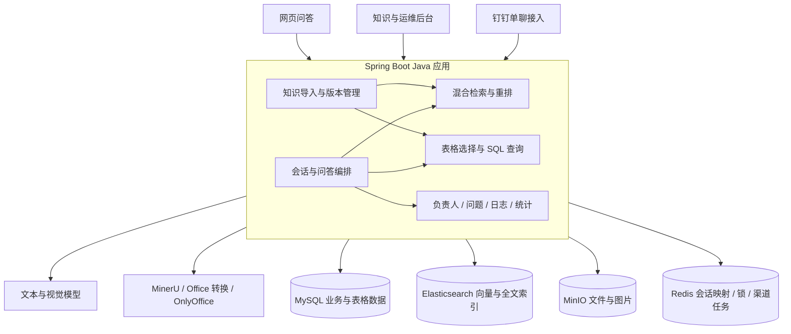
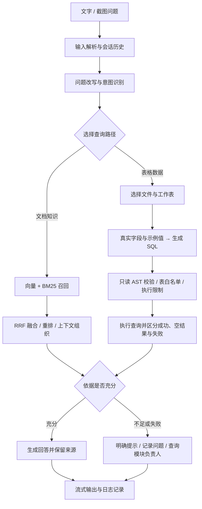
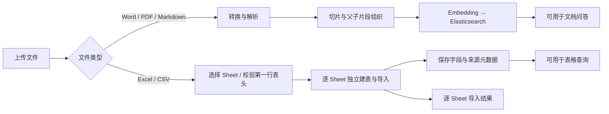

<div align="center">

# MES / MOM 运维智能助手

**把业务文档、Excel 清单与运维知识，连接到可追溯的智能问答。**


[项目概览](#项目概览) · [功能展示](#功能展示) · [技术架构](#技术架构) · [核心流程](#核心流程) · [工程实践](#工程实践)

</div>


> 本仓库用于项目成果展示，保留功能介绍、架构设计与界面截图。截图来自项目实际前端，使用虚构演示数据；不包含客户文档、生产数据、企业联系方式、访问凭据或商业项目源码。截图中的数量和统计指标不代表真实业务规模或模型效果。

## 项目概览

MES（制造执行系统）与 MOM（制造运营管理）覆盖生产、设备、质量等多个模块。运维人员遇到问题时，往往需要在操作手册、接口说明和 Excel 清单中寻找答案，再确认应由谁处理。

本项目以 Java 为主要开发语言，把这些资料组织成可查询的知识库，提供 **文档问答 + 表格查询 + 运维问题跟进**。系统根据问题选择检索路径，回答时保留来源；资料不足时记录问题，并按模块提供对应负责人。

**它既包含 AI 问答链路，也包含知识维护、账号与企业管理、日志审计和统计看板。**

### 能力一览

| 场景 | 系统能力 |
| --- | --- |
| 查操作与排错步骤 | 检索文档片段，结合上下文生成回答，展示回答依据 |
| 查数量、清单与明细 | 从 Excel 工作表选择合适的数据表，生成并校验只读 SQL |
| 连续追问 | 读取会话历史，在指代明确时沿用上一轮表格来源 |
| 发送异常截图 | 通过视觉模型提取截图信息，结合文字进入问答流程 |
| 维护知识 | 上传、转换、切片、向量化、启停、在线编辑与重新入库 |
| 资料不足 | 记录待解决问题，提供模块负责人，形成知识补充入口 |
| 回看与运营 | 查询会话与依据、查看 SQL 审计、导出日志、查看统计看板 |

## 功能展示

### 1. 文档问答：回答与依据放在一起

支持历史会话、连续提问与流式输出。文档回答可以就近展开依据，查看对应文档与原文片段，方便使用者判断答案是否有支撑。

### 2. Excel 查询：从自然语言到结构化结果

支持统计、列举与条件查询。表格回答展示“文件名 → 工作表名”，帮助用户确认查的是哪份清单；明确的连续追问可复用上一轮来源。


### 3. 知识库：让处理过程可见

统一维护 Word、PDF、Markdown、Excel 与 CSV。文档上传后转换为可处理内容，通过切片和向量化进入检索；界面展示处理进度，处理中禁用删除，避免操作与后台任务互相影响。


### 4. 多工作表导入：每张 Sheet 独立处理

上传前解析工作表，支持选择导入范围。按照“第一行为表头”的统一规则校验，每张选中的 Sheet 独立建表，逐张记录成功或失败，某一张失败不影响其他有效工作表。


### 5. 模块负责人：资料不足时也有下一步

通过后台直接维护业务、技术、运维三类负责人及各自联系方式。问答无法充分解决且模块明确时，程序查询固定业务表提供联系人，避免让模型猜测人员信息。


### 6. 会话审计与问题跟进

会话日志记录问题、回答、来源与反馈，支持筛选、详情和导出；SQL 查询额外保留最终语句与执行状态。未解决的问题进入待解决列表，供运维人员处理与补充知识。


### 7. 统计看板

展示问答量、响应耗时、问题记录、高频问题与模块分布，并提供模块异常预警。这里的数值均为界面展示用的演示数据。


## 技术架构

系统采用 **Spring Boot 单体应用 + 独立文档与模型服务**。Java 应用承担业务编排、权限范围、数据查询和资源状态管理；模型负责理解与生成，业务状态由程序控制。



| 层次 | 主要技术 | 用途 |
| --- | --- | --- |
| 业务后端 | Java 21、Spring Boot、MyBatis-Plus | API、业务编排、数据持久化 |
| AI 集成 | LangChain4j、OpenAI 兼容模型接口 | 文本生成、视觉理解、Embedding |
| 文档检索 | Elasticsearch、BM25、向量检索、RRF | 融合关键词与语义召回 |
| 精排 | BGE Reranker、ONNX Runtime | 对候选片段进一步排序 |
| 表格处理 | EasyExcel、MySQL、Druid SQL AST | 工作表解析、结构化存储、SQL 安全校验 |
| 文件服务 | MinIO、MinerU、Office 转换、OnlyOffice | 原文件、解析产物、截图与在线编辑 |
| 状态与任务 | Redis、Spring 定时任务 | 会话映射、互斥锁、重试与资源清理 |
| 用户界面 | 原生 HTML / CSS / JavaScript、SSE、ECharts | 流式问答、管理页面、可视化统计 |
| 渠道 | 钉钉 Stream 与机器人 API | 企业内部单聊；保留第三方企业接入能力 |

钉钉内部与第三方模式采用独立配置并互斥启用。企业内部接入代码已实现，仍需完整凭据与真实平台联调；仓库展示不把它标为已完成生产验证。

## 核心流程

### 问答如何选择路径



字段示例值由程序采样；表头规则由代码校验。模型调用主要用于问题理解、来源选择、SQL 生成和答案组织，避免把确定性的业务处理交给模型。

### 文件如何进入知识库



## 工程实践

项目的重点不止是调用一次模型接口，还包括把问答做成可维护的业务系统。

| 工程问题 | 实现方式与取舍 |
| --- | --- |
| 语义检索容易漏掉专有名词 | 向量与 BM25 混合召回，再融合与重排 |
| 长文档片段缺少上下文 | 父子片段组织、父片段展开与上下文长度预算 |
| 表格数量多，容易选错来源 | 保留文件、Sheet、字段与示例值；连续追问读取真实来源记录 |
| 模型 SQL 出错或越权 | 程序做 AST 只读校验、表白名单、超时与行数限制；语法修复有限重试 |
| 空结果被误认为系统错误 | 分开处理成功、零行结果、校验失败与执行失败 |
| 覆盖更新可能先丢失旧知识 | 新版本准备成功后切换，再按记录定时清理旧资源 |
| 多 Sheet 部分成功难以解释 | 独立处理、独立记录结果；长文本字段按内容适配类型 |
| 页面异步请求产生竞态 | 文件解析未结束时禁止提交，忽略过期响应，防止重复上传 |
| 机器人消息重复或处理缓慢 | 第三方消息先写 Redis 待处理队列，异步处理、去重与有限重试 |
| 无依据时生成不可靠回答 | 明确提示资料不足；联系人来自固定业务表，问题进入跟进流程 |

账号绑定企业，问答按企业可见范围与文档启用状态检索。系统没有以模型判断代替权限校验，也不声称实现了完整的生产级多租户安全体系。

## 项目边界

- 这是运维知识与问题处理助手，不直接修改生产工单、设备参数或 ERP 业务数据。
- 回答正确性依赖资料质量、检索效果与模型能力，仍需要场景评测与持续优化。
- 已对导入、查询保护、前端竞态、版本清理和渠道回调编写回归测试；没有在本展示中虚构准确率或业务收益。
- 公共仓库采用展示资料白名单，商业源码、内部交付文档和真实配置不在公开范围。

## 仓库内容

```text
MES-MOM/
├── README.md                 # 项目功能、架构、流程与工程实践
└── assets/screenshots/       # 使用演示数据生成的实际界面截图
```

本仓库面向项目交流与面试展示，不提供生产环境部署包。
